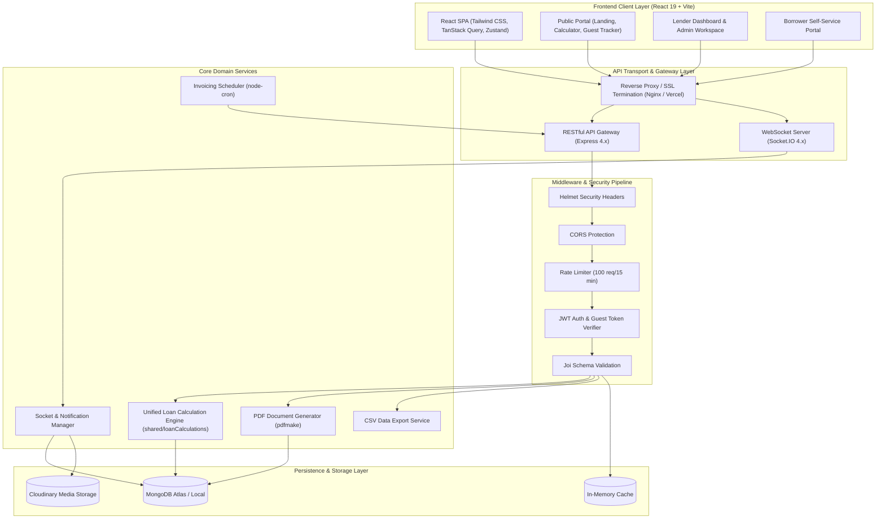
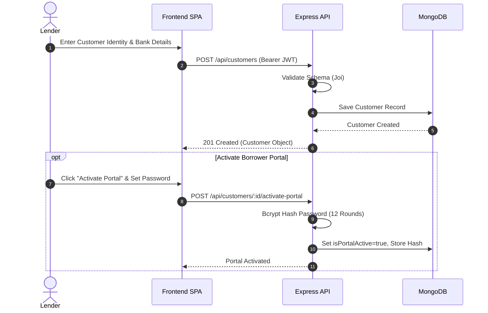
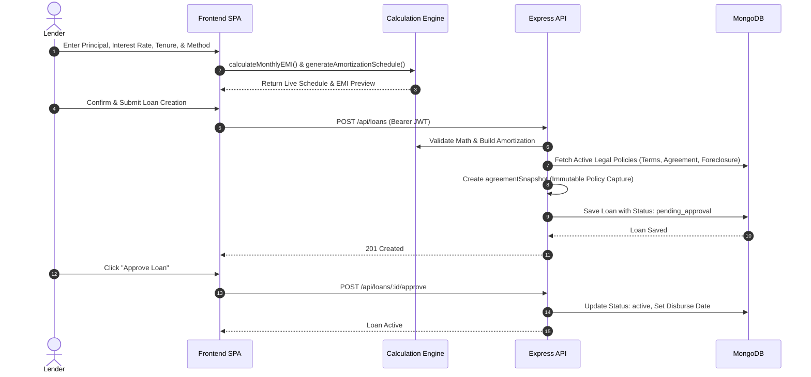
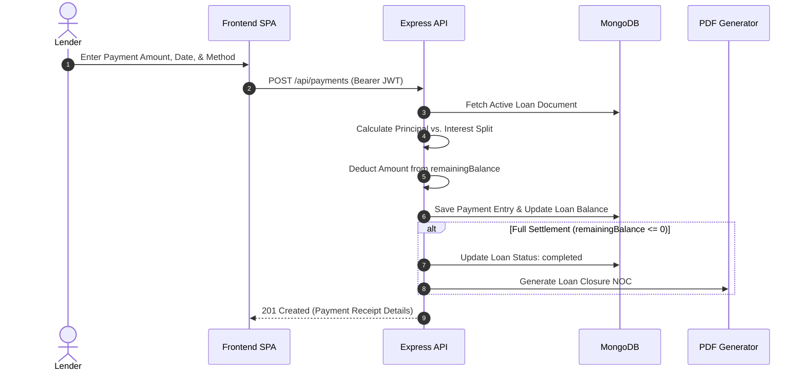
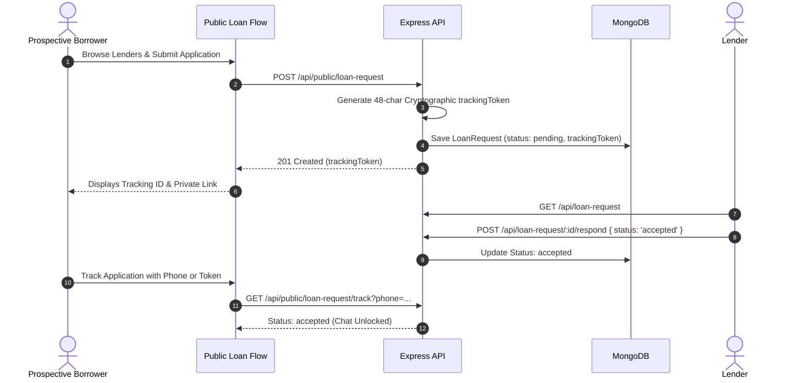

# Money-Lender App

A full-stack MERN lending ledger and credit management platform designed for private lenders and credit operations. The system centralizes borrower profiles, computes dual-engine loan amortization schedules, tracks multi-channel repayments, maintains immutable agreement snapshots, facilitates real-time chat with delivery tracking, and programmatically generates financial documentation and account statements.

---

[](LICENSE)
[](https://nodejs.org/)
[](https://react.dev/)
[](https://expressjs.com/)
[](https://www.mongodb.com/)
[](https://vitejs.dev/)
[](https://tailwindcss.com/)
[](https://socket.io/)

---

## Table of Contents

- [Project Overview](#project-overview)
- [Key Features](#key-features)
- [Technology Stack](#technology-stack)
- [System Architecture](#system-architecture)
- [Core Application Workflows](#core-application-workflows)
- [Backend Engineering Highlights](#backend-engineering-highlights)
- [Repository Structure](#repository-structure)
- [API Architecture & Reference](#api-architecture--reference)
- [Getting Started](#getting-started)
- [Testing](#testing)
- [Deployment](#deployment)
- [Security Considerations](#security-considerations)
- [Author & License](#author--license)

---

## Project Overview

Traditional private lending workflows frequently rely on physical ledgers, ad-hoc spreadsheets, error-prone interest math, and fragmented communication across messaging apps. **Money-Lender App** solves these challenges with an integrated web platform built on the MERN stack.

The platform provides dedicated workspaces for lenders alongside an accessible self-service experience for borrowers:

- **Lender Administration**: Manage customer records, evaluate incoming loan requests, configure custom loan terms, disburse funds, track live repayment stages, and monitor portfolio performance through visual analytics.
- **Customer Self-Service Portal**: Authenticated borrowers can review active loans, inspect monthly EMI schedules, download statements of account and receipts, and communicate directly with their lender.
- **Public Discovery & Guest Flow**: Prospective borrowers can browse public lender listings, calculate EMI estimates with an interactive calculator, and submit applications with a private 48-character tracking token.
- **Document Generation & Policy Tracking**: Generates server-side PDF loan contracts, statements, and closure certificates embedded with legal policy snapshots captured at loan origination.

---

## Key Features

- **Borrower Identity & Records**: Maintains complete customer records (contact info, address, bank accounts, government IDs: Aadhaar, PAN, Passport, Driving License) with soft-deletion support (`isDeleted: true`).
- **Portal Credential Provisioning**: Lenders can activate/deactivate borrower portal access with dedicated credentials and 12-round `bcryptjs` password hashing.
- **State-Machine Loan Lifecycle**: Enforces structured lifecycle states: `pending_approval` -> `approved` -> `active` -> `completed` (or `foreclosed`, `defaulted`, `cancelled`).
- **Dynamic Delinquency Staging**: Evaluates delinquency stages at request time based on due dates and payment records without requiring database batch cron updates: `Upcoming`, `Due Today`, `Grace Period`, `Overdue`, and `Default`.
- **Dual Amortization Engine**: Computes Flat Rate (simple interest) and Reducing Balance (compound interest) schedules with monthly principal, interest, and balance breakdowns.
- **Repayment Ledger**: Records payments across cash, UPI, bank transfer, and cheque; splits principal/interest dynamically; updates running balances; and handles loan closure upon zero balance.
- **Real-Time Chat & Delivery Ticks**: Bidirectional lender-borrower messaging over Socket.IO with delivery states (`sent` -> `delivered` -> `seen`), unread badge summaries, and Cloudinary media attachments.
- **Server-Side PDF Generation**: Programmatically renders downloadable PDF loan agreements, payment receipts, statements of account, and closure NOCs via `pdfmake`.
- **Legal Policy Governance**: Versioned administrative policy manager covering 8 legal policy types (Terms of Service, Loan Agreement, Privacy Policy, Foreclosure Policy, etc.).

---

## Technology Stack

| Layer | Technologies & Libraries | Role |
| :--- | :--- | :--- |
| **Frontend Core** | React 19, Vite 7 | SPA UI rendering, build tooling, and client-side routing |
| **State & Data Fetching** | TanStack Query v5, Zustand 5 | Server state caching, optimistic updates, and persistent auth store |
| **Styling & UI** | Tailwind CSS v4, Lucide React, Phosphor Icons | Responsive layout, theme variables, and icon design system |
| **Visualization** | Recharts, Framer Motion, Anime.js | Portfolio analytics charts, data visualization, and micro-interactions |
| **Forms & Validation** | React Hook Form, Zod | Client-side form management, schema validation, and error states |
| **Backend Core** | Node.js 18+, Express 4.18 | RESTful API gateway, HTTP request routing, and business controllers |
| **Database & ODM** | MongoDB, Mongoose 8.0 | Document persistence, schema validation, indexes, and aggregation |
| **Real-Time Gateway** | Socket.IO 4.8 (Client & Server) | WebSocket event communication, room isolation, and delivery sync |
| **Security & Middleware** | Helmet, CORS, Express Rate Limit, Joi | Security headers, origin checks, IP rate limiting, and request validation |
| **Authentication** | JSON Web Tokens (`jsonwebtoken`), Bcrypt.js | Stateless role-based auth (Lender vs. Customer) and password hashing |
| **Document & Media** | pdfmake, Cloudinary, Multer | Dynamic server-side PDF compilation and cloud attachment storage |
| **Testing Suite** | Jest, Supertest, mongodb-memory-server | Calculation engine unit tests, API integration tests, and in-memory DB |

---

## System Architecture



---

## Core Application Workflows

### 1. Customer Onboarding & Portal Activation



### 2. Loan Creation, Amortization & Agreement Snapshotting



### 3. Payment Processing & Running Balance Adjustment



### 4. Guest Loan Request & Public Tracking



---

## Backend Engineering Highlights

### 1. Dual-Engine Amortization Core (`shared/loanCalculations.js`)

The calculation engine is implemented as an isomorphic module shared between frontend preview components and backend loan creation. It supports two financial calculation methods:

- **Flat Rate (Simple Interest)**:

  ```text
  EMI = (P + (P * r * n)) / n
  ```

  *(where P = Principal, r = Monthly interest rate in decimal, n = Duration in months)*

- **Reducing Balance (Compound Interest)**:

  ```text
  EMI = [P * r * (1 + r)^n] / [(1 + r)^n - 1]
  ```

  *(where P = Principal, r = Monthly interest rate in decimal, n = Duration in months)*

- **Dynamic Delinquency Computation**: Delinquency stages (`Upcoming`, `Due Today`, `Grace Period`, `Overdue`, `Default`) are calculated dynamically upon every request by evaluating the loan's next installment date, grace window, and payment history. This avoids state drift caused by missed background cron jobs.

### 2. Repayment Ledger & Balance Integrity (`backend/src/controllers/paymentController.js`)

- **Dynamic Principal-Interest Allocation**: When a payment is recorded, the controller calculates interest accrued vs. principal reduction, decrements `remainingBalance`, and records running balance snapshots per transaction.
- **Automatic Lifecycle Completion**: When `remainingBalance` reaches `<= 0`, the system automatically transitions loan status to `completed`, triggers loan closure routines, and issues a Loan Closure NOC document.
- **Balance Rollback on Reversal**: When a payment record is deleted by an administrator, the controller reverts the loan's balance and status accordingly to maintain ledger consistency.

### 3. Immutable Legal Policy Snapshotting (`backend/src/controllers/loanController.js`)

To prevent disputes arising from terms updated after a loan was issued, the backend snapshots the exact text and version numbers of active legal policies (Terms of Service, Loan Agreement, Foreclosure Policy) at the time of loan creation:

```text
Loan Document
└── agreementSnapshot
    ├── policySnapshots: [ { type: "terms_of_service", version: "1.2", content: "..." }, ... ]
    ├── capturedAt: ISODate
    └── isCustomized: Boolean
```

Subsequent modifications to administrative policies create new versioned policy records but never mutate existing loan agreement snapshots.

### 4. Real-Time Chat & Delivery Lifecycle (`backend/src/socket/socketManager.js`)

- **Delivery State Lifecycle**: Implements full tracking across message delivery stages: `sent` (server received) -> `delivered` (recipient socket received) -> `seen` (recipient opened chat room).
- **Socket Authentication & Rooms**: Integrates JWT verification and tracking-token validation for room authorization (`loan_${loanRequestId}`), ensuring messages are scoped strictly to the lender and borrower involved.
- **Offline Delivery & Unread Aggregation**: Unread counters and notifications are synchronized when an offline user reconnects.

### 5. Programmatic Server-Side Document Generation (`backend/src/utils/pdfGenerator.js`)

Using `pdfmake`, the application dynamically compiles print-ready financial PDFs:

- **Loan Agreements**: Formats loan terms, repayment schedules, borrower identity data, and the embedded `agreementSnapshot`.
- **Statements of Account**: Chronological ledger of all debits, credits, and outstanding balances.
- **Payment Receipts & Closure NOCs**: Structured official receipts and No Objection Certificates generated upon loan completion.

### 6. Defense-in-Depth Security Pipeline

- **Stateless Dual-Role Authentication**: Segregated JWT authentication distinguishing lender administration from borrower self-service access.
- **Cryptographic Guest Tokens**: Unauthenticated guest applications are accessed via 48-character hex tokens generated with `crypto.randomBytes(24).toString('hex')`.
- **Validation & Hardening**: Every mutation endpoint is guarded by strict `Joi` schema validation, `bcryptjs` 12-round hashing, `helmet` security headers, origin-restricted `cors`, and IP rate-limiting (`express-rate-limit`).

---

## Repository Structure

```text
Money-Lender-App/
├── .gitignore                      # Git exclusion rules
├── LICENSE                         # Custom source-available license
├── README.md                       # Project documentation
├── DESIGN.md                       # Design system tokens and styling guide
├── skills-lock.json                # Project agent skills configuration
│
├── backend/                        # Node.js + Express backend service
│   ├── .env.example                # Environment variables template
│   ├── jest.config.js              # Jest test runner configuration
│   ├── package.json                # Backend dependencies and scripts
│   ├── __tests__/                  # Unit and integration test suites
│   ├── migrations/                 # Database schema migration scripts
│   ├── scripts/
│   │   └── seedData.js             # Development database seed script
│   └── src/
│       ├── config/                 # Database connection and system constants
│       ├── controllers/            # Route business logic handlers (18 controllers)
│       ├── middleware/             # Auth, error handling, and Joi validation
│       ├── models/                 # Mongoose schemas (Loan, Customer, Payment, etc.)
│       ├── routes/                 # Express API routes (18 modular routers)
│       ├── socket/
│       │   └── socketManager.js    # Socket.IO connection and event lifecycle
│       ├── utils/                  # PDF generators, calculators, and schedulers
│       └── server.js               # Application entry point and HTTP/WS server setup
│
├── frontend/                       # React 19 + Vite frontend application
│   ├── index.html                  # HTML5 entry template
│   ├── package.json                # Frontend dependencies and build scripts
│   ├── tailwind.config.js          # Tailwind CSS design system tokens
│   ├── vite.config.js              # Vite configuration and server proxy rules
│   └── src/
│       ├── App.jsx                 # Route definitions and application layout tree
│       ├── main.jsx                # DOM mount and root provider initialization
│       ├── components/             # Reusable UI components (modals, tables, layout)
│       ├── contexts/               # React contexts (SocketContext, etc.)
│       ├── hooks/                  # Custom React hooks (useTheme, useLegal, etc.)
│       ├── pages/                  # Page views grouped by business feature
│       ├── services/
│       │   └── api.js              # Axios instance and centralized API client
│       ├── store/                  # Zustand persistent auth state store
│       └── utils/                  # Client-side formatting and helper functions
│
├── shared/                         # Shared isomorphic logic
│   └── loanCalculations.js         # Single source of truth for loan mathematics
│
└── scripts/
    └── migrate-design-tokens.mjs   # Design token migration utility
```

---

## API Architecture & Reference

All protected lender endpoints require an `Authorization: Bearer <JWT_TOKEN>` header with a lender role. Protected customer endpoints require a customer JWT. Guest tracking endpoints require the `X-Tracking-Token: <TOKEN>` header.

| Domain | Route Prefix | Access Level | Description | Key Endpoints |
| :--- | :--- | :--- | :--- | :--- |
| **Authentication** | `/api/auth`, `/api/customer-auth` | Public / Role JWT | Lender registration/login and customer portal authentication | `POST /login`, `POST /register`, `GET /me` |
| **Customers** | `/api/customers` | Protected (Lender) | Customer profile management, ID storage, and portal provisioning | `GET /`, `POST /`, `POST /:id/activate-portal` |
| **Loan Lifecycle** | `/api/loans` | Protected (Lender) | Loan origination, amortization schedule, approval, and foreclosure | `POST /`, `POST /:id/approve`, `POST /:id/foreclose` |
| **Payments** | `/api/payments` | Protected (Lender/Customer) | Payment recording, ledger allocation, and receipt generation | `POST /`, `GET /loan/:loanId`, `GET /:id/receipt` |
| **Financial Docs** | `/api/loans/:id` | Protected | Server-side PDF generation for agreements, statements, and closure | `GET /:id/agreement`, `GET /:id/statement`, `GET /:id/noc` |
| **Requests & Chat** | `/api/loan-request`, `/api/chat` | Dual-Auth / Guest Token | Loan applications, Socket.IO message history, and file uploads | `POST /loan-request`, `GET /chat/:id/messages`, `POST /upload` |
| **Public Flow** | `/api/public`, `/api/calculator` | Public | Public lender discovery, EMI calculator, and guest application tracking | `POST /calculator/estimate`, `POST /public/loan-request` |
| **Governance & Stats** | `/api/legal`, `/api/stats`, `/api/export` | Public / Protected | Legal policy versions, portfolio analytics, and CSV transaction exports | `GET /legal/public`, `GET /stats`, `GET /export/loans` |

---

## Getting Started

### Prerequisites

Ensure you have the following installed on your development machine:

- **Node.js**: `v18.0.0` or higher
- **npm**: `v9.0.0` or higher
- **MongoDB**: Local MongoDB instance (`mongodb://localhost:27017`) or a [MongoDB Atlas](https://www.mongodb.com/atlas) connection URI

---

### Installation

1. **Clone the repository**:

   ```bash
   git clone https://github.com/Rajdeep2922/Money-Lender-App.git
   cd Money-Lender-App
   ```

2. **Install Backend Dependencies**:

   ```bash
   cd backend
   npm install
   cd ..
   ```

3. **Install Frontend Dependencies**:

   ```bash
   cd frontend
   npm install
   cd ..
   ```

---

### Environment Configuration

#### 1. Backend Configuration (`backend/.env`)

Create a `.env` file in the `backend/` directory (refer to `backend/.env.example`):

```bash
cp backend/.env.example backend/.env
```

Populate the configuration values:

```env
# Server Configuration
PORT=5000
NODE_ENV=development

# Database Connection
MONGODB_URI=mongodb://localhost:27017/moneylender

# Authentication Security
JWT_SECRET=replace_with_a_secure_random_secret_at_least_32_characters_long
JWT_EXPIRES_IN=7d

# Frontend Origin (Required for CORS & PDF Agreement Links)
FRONTEND_URL=http://localhost:5173

# Rate Limiting (Requests per 15-minute window)
RATE_LIMIT_MAX=100

# Optional: Cloudinary Configuration (Required for chat file attachments)
CLOUDINARY_CLOUD_NAME=your_cloud_name
CLOUDINARY_API_KEY=your_api_key
CLOUDINARY_API_SECRET=your_api_secret
```

#### 2. Frontend Configuration (`frontend/.env`)

Create a `.env` file in the `frontend/` directory:

```env
# Backend API Base URL
VITE_API_URL=http://localhost:5000/api
```

---

### Database Seeding

To populate your local development database with sample lenders, customers, loan agreements, and payments:

```bash
cd backend
node scripts/seedData.js
cd ..
```

---

### Running the Application

Start the backend and frontend development servers in separate terminals:

**Terminal 1 — Backend API & WebSocket Server:**

```bash
cd backend
npm run dev
```

*The backend starts on `http://localhost:5000` with WebSocket support enabled.*

**Terminal 2 — Frontend Application:**

```bash
cd frontend
npm run dev
```

*The Vite development server will start on `http://localhost:5173`.*

---

## Testing

The backend includes a comprehensive Jest test suite with in-memory MongoDB testing:

```bash
# Navigate to backend directory
cd backend

# Run all test suites
npm test

# Run tests in watch mode during development
npm run test:watch

# Generate test coverage report
npm run test:coverage
```

### Key Test Coverage Areas

- **Interest Math & Schedule Engine**: Validates Flat Rate vs. Reducing Balance formulas, monthly amortization progressions, and late fee bounds.
- **Custom Agreements**: Validates parameter constraints, tenure conversions, and agreement snapshot generation.
- **Socket Delivery States**: Validates message status transitions (`sent` -> `delivered` -> `seen`), offline sync, and room security.
- **Notification Summaries**: Tests unread counter aggregation across active loan requests and customer chats.

---

## Deployment

- **Frontend:** Vercel
- **Backend:** Render
- **Database:** MongoDB Atlas

The application is deployed across decoupled cloud platforms:

- **Frontend (Vercel)**: Built with `npx vite build` into static assets (`frontend/dist`) and served through Vercel's global CDN. Single-page client-side routing is handled via `frontend/vercel.json` rewrites. The `VITE_API_URL` environment variable routes API requests to the backend service.
- **Backend (Render)**: Hosted as a Node.js web service running `npm start`. Production environment variables (`MONGODB_URI`, `JWT_SECRET`, `FRONTEND_URL`, `NODE_ENV=production`) configure database connectivity, rate limiting, and CORS origins.
- **Database (MongoDB Atlas)**: Hosted on a managed MongoDB Atlas cloud cluster with TLS/SSL encryption and authentication.

---

## Security Considerations

The application implements defensive security practices across client and server layers:

- **Role-Segregated JWT Auth**: Differentiates lender administrative access from borrower self-service access.
- **Password Protection**: Passwords are salted and hashed using `bcryptjs` with 12 salt rounds (never stored in plain text; excluded from database queries by default).
- **Cryptographic Guest Tokens**: Guest loan requests are authorized using 48-character hex tokens generated with `crypto.randomBytes(24).toString('hex')`.
- **Request Validation**: Payload inputs are strictly validated against `Joi` schemas prior to reaching controller handlers.
- **HTTP Header Hardening**: Integrated `helmet` middleware configures standard defensive HTTP headers (`X-Content-Type-Options`, `X-Frame-Options`, etc.).
- **Rate Limiting & CORS**: `express-rate-limit` prevents abusive request floods; CORS restricts cross-origin access strictly to declared frontend origins.
- **Contract Integrity**: Policy snapshots freeze legal terms inside loan documents at origination, ensuring historical terms remain immutable.

---

## Author & License

**Money-Lender App** is maintained by:

- **Author**: [Rajdeep2922](https://github.com/Rajdeep2922)
- **Repository**: [https://github.com/Rajdeep2922/Money-Lender-App](https://github.com/Rajdeep2922/Money-Lender-App)

### License

This project is distributed under a custom source-available license. Personal, educational, and portfolio evaluation use is permitted. Commercial use, business deployment, redistribution, and derivative commercial distribution require explicit written permission from the copyright holder.

See the [LICENSE](LICENSE) file for complete terms and conditions.
